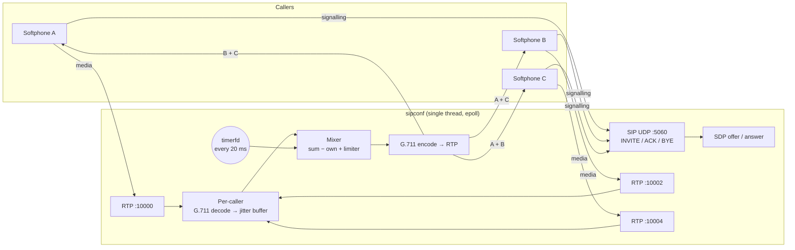

# sipconf: a SIP/RTP audio conference server in pure C

A multi-party voice conference bridge written in C11 using only libc and Linux/POSIX system calls. It has no PJSIP, no Asterisk, and no third-party libraries. Any SIP softphone can dial in. The server mixes everyone's audio in real time and sends each caller everyone *except themselves* (mix-minus).

> **Background.** This project grew out of earlier internship work on real-time voice conferencing, where a from-scratch POSIX approach was set aside in favour of an established VoIP stack. This repository is my own independent take on the from-scratch approach, written on my own time to work out what it takes to make it work properly.
>
> This repo shows the design, results and key code excerpts. The full source is private.

---

## What it does

| Area | Implementation |
|---|---|
| **Signalling** | SIP over UDP (RFC 3261 subset): `INVITE`, `ACK`, `BYE`, `OPTIONS`, `CANCEL`; re-INVITE; compact header forms; `486 Busy` when the room is full; `488` when there's no usable codec |
| **Session description** | SDP offer/answer (RFC 4566 / 3264): negotiates G.711 µ-law (`PCMU/8000`) |
| **Media** | RTP (RFC 3550): parses CSRC lists, header extensions and padding; one even-numbered UDP port per participant |
| **Codec** | G.711 µ-law encoder/decoder written from the ITU-T spec |
| **Jitter buffer** | Per-participant FIFO of 20 ms frames: primes at 40 ms, re-primes after an underrun, drops the oldest frame on overflow |
| **Mixer** | Mix-minus: one shared sum per tick, then subtract each listener's own frame, giving O(N) instead of O(N²) |
| **Limiter** | Per-listener gain (instant attack, ~0.5 s release) keeps several loud talkers from hard-clipping |
| **NAT** | Symmetric RTP: replies go to wherever the caller's media actually comes from |
| **Event loop** | Single thread: `epoll` for all sockets, `timerfd` as the 20 ms media clock, `signalfd` for clean shutdown |
| **Observability** | Per-frame mixer timing, late timer ticks, per-caller rx/tx, sequence gaps, jitter-buffer depth, underruns, limiter activity |

## Architecture



There is a full write-up (call flow, media pipeline, latency budget, design trade-offs) in [`docs/ARCHITECTURE.md`](docs/ARCHITECTURE.md).

## Code excerpts

| File | What it shows |
|---|---|
| [`excerpts/event_loop.c`](excerpts/event_loop.c) | Single-threaded `epoll` loop with `timerfd` as the media clock |
| [`excerpts/jitter_buffer.c`](excerpts/jitter_buffer.c) | Priming, underrun re-priming, overflow handling |
| [`excerpts/mixer.c`](excerpts/mixer.c) | Mix-minus mixing, the limiter, RTP send, per-frame timing |

## Testing

I verified the server with a simulator that places real SIP calls. Each simulated caller streams a pure tone at its own frequency and records what it hears. A Goertzel filter then checks that every caller hears every *other* tone and not its own:

```
caller     tone  rx sec   power heard per tone (own tone in [ ])
0         350Hz    4.22   [   57dB]   114dB    114dB
1        1850Hz    4.22      114dB [  -30dB]   114dB
2        3350Hz    4.22      114dB    114dB [   73dB]

mix-minus check: PASS
```

The code was also built with AddressSanitizer + UBSan and fed malformed SIP and RTP. Every bad input was rejected or counted, with no crashes or sanitizer reports.

## Measured performance

Measured on a 2-vCPU Linux VM, `-O2`, loopback, every caller talking continuously:

| Callers | Mix time per 20 ms frame (avg / max) | Late ticks | Packet loss | Mix-minus |
|---|---|---|---|---|
| 3 | 49 µs / 135 µs | 0 | 0 | PASS |
| 8 | 79 µs / 719 µs | 0 | 0 | PASS |
| 12 | 78 µs / 316 µs | 0 | 0 | PASS |
| 16 (max) | 147 µs / 453 µs | 0 | 0 | PASS |
| 17 | 17th caller rejected with `486 Busy Here` | | | |

The slowest single frame measured was under 1 ms, less than 5% of the 20 ms budget. Latency is dominated by buffering (about 20–40 ms of jitter buffer) and by codec choice, not by processing.

## A bug the tests caught

The first version simply hard-clipped the mixed sum to 16 bits. That passed with 3 callers and failed at 12: each caller heard its **own** tone only about 12 dB below everyone else's. With 11 people talking, the sum exceeded ±32767. Clipping distorted the waveform, and the distortion created intermodulation products that landed on the listener's own frequency. In a real call that sounds like harsh crackle whenever several people talk at once.

The fix was a per-listener limiter. If a frame's peak would exceed 30000, the whole frame is scaled down (fast attack), and the gain then recovers over about half a second. With that change, own-tone leakage dropped to about 35–55 dB below the other callers at every tested size up to 16.

## Known limitations

- UDP only, G.711 only (no TLS/SRTP, no Opus or wideband)
- A single conference room
- No authentication; meant for trusted networks only
- No session timers or RTCP
- The jitter buffer plays packets in arrival order, with no reordering or loss concealment

## Next steps

- Add a per-participant noise-suppression stage (e.g. RNNoise) between decode and mix
- Opus/G.722 wideband audio
- RTCP reports, multiple rooms

---

© 2026 Roshan Abdul Rauof. All rights reserved. The excerpts are shown for portfolio purposes.
