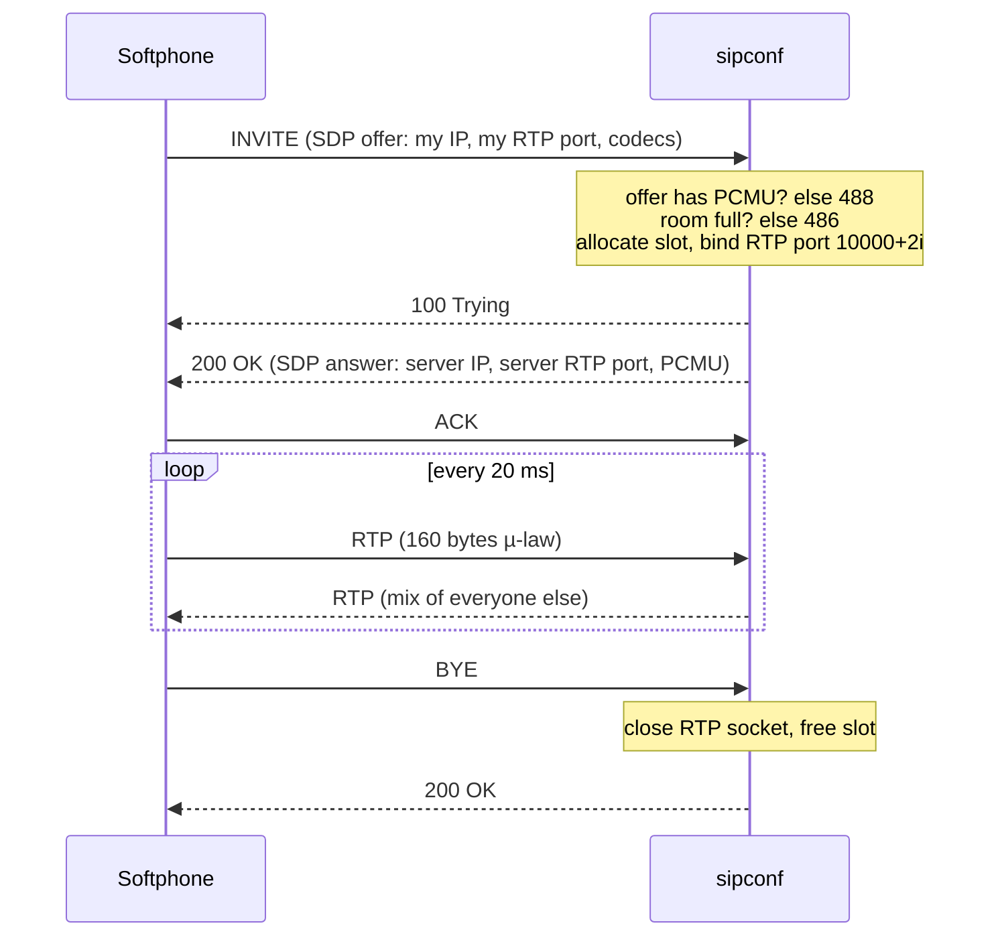

# Architecture

## 1. Threading model

Everything runs in **one thread**. All inputs are file descriptors registered with a single `epoll` instance:

| fd | Type | Triggers |
|---|---|---|
| SIP socket | UDP, non-blocking | SIP request arrives |
| RTP socket × N | UDP, non-blocking, one per caller | media packet arrives |
| `timerfd` | `CLOCK_MONOTONIC`, 20 ms interval | time to produce the next output frame |
| `signalfd` | SIGINT / SIGTERM | clean shutdown |

Why not threads? The work per event is tiny (microseconds), so one thread is nowhere near saturated even at the 16-caller limit. With a single thread there are no locks, no races between "packet arrived" and "mix now", and behaviour is deterministic and easy to debug. The `epoll_event.data.u64` field encodes `(type << 32) | index`, so dispatch is a `switch` with no lookup table.

Why a `timerfd` and not "mix when a packet arrives"? Callers' clocks drift and their packets arrive in bursts. The output must leave at a steady 50 packets/s regardless, so the server needs its own media clock. `timerfd` reports how many intervals expired since the last read. If the loop ever falls behind, the server counts those as `late` ticks and catches up (capped at 5 frames, so it never bursts indefinitely).

## 2. Call flow



The server answers immediately (no ringing), so `CANCEL` has nothing to cancel and simply gets a `200`. A re-INVITE with the same `Call-ID` updates the media address without creating a new participant.

## 3. Media pipeline (per 20 ms tick)

```
         receive path (event-driven)                    send path (timer-driven)
RTP pkt ─► parse ─► G.711 decode ─► assemble 160 ─► JB ─┐
RTP pkt ─► parse ─► G.711 decode ─► assemble 160 ─► JB ─┼─► sum ─► (sum − own) × gain ─► encode ─► RTP
RTP pkt ─► parse ─► G.711 decode ─► assemble 160 ─► JB ─┘
```

1. **Receive.** Each RTP packet is validated: version 2, CSRC list, extension and padding bounds all checked against the datagram length. Non-PCMU packets are counted as `bad`. Decoded samples go into an assembly buffer that emits exact 160-sample (20 ms) frames, so callers using 10 ms or 30 ms packets still work.
2. **Jitter buffer.** A FIFO of up to 8 frames. Playout starts once 2 frames (40 ms) are queued. If it runs dry, it plays silence and *re-primes*, waiting for 2 frames again, so a burst after a gap doesn't immediately underrun again. If it overflows, the oldest frame is dropped, which bounds latency at 160 ms.
3. **Mix.** Each tick pulls one frame per participant and builds a single 32-bit sum. Each listener's output is `sum − own_frame`. That is O(N) per tick instead of summing N−1 inputs for each of N listeners (O(N²)).
4. **Limit.** Each listener's frame peak is measured. If it would exceed 30000, the gain drops to bring it under (instant attack). Otherwise the gain recovers 4% of the way to 1.0 per frame (about 0.5 s release). Gain is constant within a frame, so it doesn't distort the waveform the way clipping does.
5. **Send.** Each output frame is µ-law encoded and sent as RTP with a per-listener SSRC, a sequence number, and a timestamp advancing by 160 per frame.

## 4. Latency budget

| Component | Delay | Notes |
|---|---|---|
| Packetisation at the phone | 20 ms | one frame per packet |
| Network | variable | ~0 on LAN |
| Jitter buffer | 20–40 ms typical, ≤160 ms max | `JB_PRIME` / `JB_FRAMES` in `config.h` |
| Mixer wait (timer phase) | 0–20 ms | waiting for the next tick |
| Mix + encode | ~0.05–0.15 ms avg, < 1 ms worst | measured, see README |
| Codec algorithmic delay | 0 ms | G.711 has no look-ahead |

The processing cost is negligible. In practice, latency comes from **buffering and codec choice**. Swapping G.711 for a compressed codec with look-ahead, or using larger frames, adds 20–40 ms by itself. The `jb(ms)` column in the stats shows the real buffered depth per caller.

## 5. Design trade-offs

| Decision | Alternative | Why this way |
|---|---|---|
| Raw syscalls, no libraries | PJSIP / Asterisk / FreeSWITCH | Makes every layer visible: parsing, timing, buffering, mixing. Production systems should use a mature stack. |
| G.711 only | Opus | No codec library needed, zero codec delay. Narrowband (300–3400 Hz) is the cost. |
| Single room, fixed slots | Dynamic rooms | Bounded memory; static arrays, no `malloc` in the media path. |
| Arrival-order jitter buffer | Sequence-ordered + PLC | Simple and correct on LAN; reordering/concealment listed as next steps. |
| Symmetric RTP | ICE / STUN | Handles common NAT without extra protocol; trusted-network only. |
